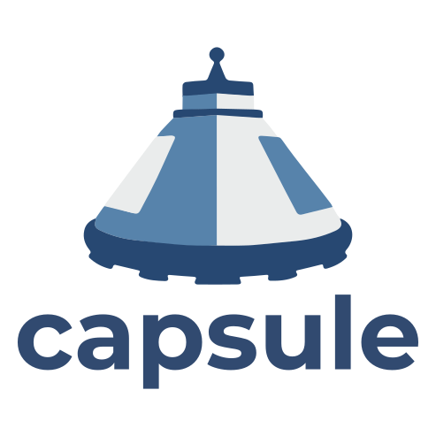

<p align="left">
  <a href="https://grc.store/targets/capsule/capsule">
    
  </a>
  
  
  <a href="https://github.com/projectcapsule/capsule/releases">
    
  </a>
  <a href="https://charmhub.io/capsule-k8s">
    
  </a>
  <a href="https://www.bestpractices.dev/projects/5601">
    
  </a>
  <a href="https://securityscorecards.dev/viewer/?uri=github.com%2Fprojectcapsule%2Fcapsule">
    
  </a>
  <a href="https://artifacthub.io/packages/search?repo=projectcapsule">
    
  </a>
  <a href="https://app.fossa.com/projects/git%2Bgithub.com%2Fprojectcapsule%2Fcapsule?ref=badge_shield&issueType=license" alt="FOSSA Status">
    
  </a>
  <a href="https://insights.linuxfoundation.org/project/capsule" alt="LFX Active Contributors">
    
  </a>
  <a href="https://insights.linuxfoundation.org/project/capsule" alt="LFX Health Score">
    
  </a>
</p>

<p align="center">
  
</p>

---

**Join the community** on the [#capsule](https://kubernetes.slack.com/archives/C03GETTJQRL) channel in the [Kubernetes Slack](https://slack.k8s.io/).

# Kubernetes multi-tenancy made easy

**Capsule** is a multi-tenancy framework for Kubernetes. It gives teams the freedom to create and manage their own namespaces, while access, resource budgets, and policies stay under platform control. It runs as a Kubernetes operator and relies only on upstream Kubernetes: no custom distribution and no extra tooling for your users to learn.

# What's the problem with the current status?

Kubernetes namespaces have no hierarchy. As soon as multiple teams or customers share a cluster, the choices are all costly:

- **Namespaces only**: cluster admins become a bottleneck, and developers cannot list their own namespaces.
- **A custom CRD**: your teams learn an API that exists on your cluster and nowhere else.
- **Multiple clusters**: another control plane per team to upgrade, secure, and pay for, known as _clusters sprawl_.

# Entering Capsule

Capsule groups a team's namespaces into a _Tenant_, a lightweight cluster-scoped resource. Cluster administrators define the tenant's owners, rules, and budgets once, and every namespace in the tenant inherits them. Tenant owners then create ordinary namespaces on their own, without cluster-admin rights or a ticket.

| Role | Responsibility |
| --- | --- |
| **Cluster Admin** | Installs Capsule, creates Tenants, and sets resource budgets and policies. |
| **Tenant Owner** | Creates and manages namespaces within their Tenant and grants access to team members. |
| **Tenant User** | Deploys workloads inside tenant namespaces, within the limits the owner has set. |

```yaml
apiVersion: capsule.clastix.io/v1beta2
kind: Tenant
metadata:
  name: solar
spec:
  owners:
    - name: alice
      kind: User
```

Capsule enforces the boundaries through admission control: it grants owners access, applies the configured quotas and policies, and rejects requests that fall outside the tenant's rules.

# Project Status
This project is stable. [We follow the Kubernetes definition of stable](https://kubernetes.io/docs/reference/command-line-tools-reference/feature-gates/#feature-stages).

# Quick start

Capsule is installed with its [Helm chart](https://artifacthub.io/packages/helm/capsule/capsule), which also manages the CustomResourceDefinitions. [cert-manager](https://cert-manager.io/) is used for the webhook certificates by default.

```bash
helm install capsule oci://ghcr.io/projectcapsule/charts/capsule -n capsule-system --create-namespace
```

Then follow the [quickstart](https://projectcapsule.dev/docs/quickstart/) to create your first Tenant, or try the [live demo](https://killercoda.com/projectcapsule/scenario/demo).

# Features

## Tenants

Group namespaces by team, product, or customer. Owners manage their namespaces and grant developers access to deploy applications. RBAC bindings are propagated to every namespace automatically.

## Namespace rules

Configure policy on a per-namespace basis. Namespace selectors give namespaces within the same Tenant different profiles. Rules mutate new resources (such as workload placement, seccomp, AppArmor, or Gateway references) and enforce policies on the result, for example allowed registries, workload types, ingress hostnames, NetworkPolicy CIDRs, and namespace metadata. Rules can be applied conditionally with CEL expressions.

## Resource management

Control the resources consumed by tenants and prevent them from overtaking:

- `GlobalResourceQuota` enforces one shared ceiling across selected namespaces.
- `ResourcePool` allocates capacity to namespaces through claims.
- `CustomQuota` and `GlobalCustomQuota` limit custom quantities calculated from any Kubernetes object.

## Replications

Propagate Secrets, NetworkPolicies, LimitRanges, and other resources into tenant namespaces with `TenantResource` and `GlobalTenantResource`, using Go templates for values such as the namespace or tenant name.

## Capsule Proxy

Let tenant users list only their own namespaces, pods, and volumes through the standard Kubernetes API with their existing tools. Capsule Proxy is optional and released separately.

## Self-service, GitOps ready, and a native experience

Developers self-provision within their assigned boundaries. Everything is declarative and GitOps ready, built on plain Kubernetes without additional management layers or customized binaries.

## Ecosystem

Tenant namespaces are ordinary namespaces, so your tools keep working. Integrations for Argo CD, Rancher, OpenShift, Headlamp, Kyverno, Velero, Crossplane, Tekton, and more make them tenant-aware. See the [ecosystem](https://projectcapsule.dev/ecosystem/).

# Documentation

Please check the project [documentation](https://projectcapsule.dev) for the cool things you can do with Capsule. [What's new](https://projectcapsule.dev/docs/whats-new/) lists the features of the current release.

## Project repositories

| Repository | Scope |
| --- | --- |
| [Capsule](https://github.com/projectcapsule/capsule) | Controller, namespace profiling rules, admission webhooks, and Helm chart. |
| [Capsule Proxy](https://github.com/projectcapsule/capsule-proxy) | Optional Kubernetes API proxy for tenant users, developed and released separately. |
| [Website](https://github.com/projectcapsule/website) | Source for the user documentation and project website. |
| [Community](https://github.com/projectcapsule/capsule-community) | Community coordination and meeting materials. |

Capsule and Capsule Proxy are the runtime codebases. The website and community
repositories support documentation and collaboration. The [release process](DEVELOPMENT.md#release-process)
in this repository builds and publishes the Capsule controller and Helm chart.

# Contributions

Capsule is Open Source with Apache 2 license and any contribution is welcome.

## Community meeting

Join the community, share and learn from it. You can find all the resources to how to contribute code and docs, connect with people in the [community repository](https://github.com/projectcapsule/capsule-community).

Please read the [code of conduct](CODE_OF_CONDUCT.md).

## Adopters

See the [ADOPTERS.md](ADOPTERS.md) file for a list of companies that are using Capsule.

# Project Governance

You can find how the Capsule project is governed [here](https://projectcapsule.dev/project/governance/).

## Maintainers

Please refer to the maintainers file available [here](.github/maintainers.yaml).

## CLOMonitor

CLOMonitor is a tool that periodically checks open source project repositories to verify they meet certain project health best practices.

[](https://clomonitor.io/projects/cncf/capsule)

### Changelog

Read how we log changes [here](CHANGELOG.md)

### Software Bill of Materials

All OCI release artifacts include a Software Bill of Materials (SBOM) in CycloneDX JSON format. More information about this is available [here](SECURITY.md#software-bill-of-materials-sbom)

# FAQ

- Q. How do you pronounce Capsule?

  A. It should be pronounced as `/ˈkæpsjuːl/`.

- Q. Is it production grade?

  A. Although under frequent development and improvement, Capsule is ready to be used in production environments as currently, people are using it in public and private deployments. Check out the [release](https://github.com/projectcapsule/capsule/releases) page for a detailed list of available versions.

- Q. Does it work with my Kubernetes XYZ distribution?

  A. Our end-to-end tests run against vanilla Kubernetes 1.33 to 1.35 and against OpenShift (MicroShift). We expect Capsule to work on any other conformant Kubernetes distribution. Please let us know if you find it doesn't.

- Q. Do you provide commercial support?

  A. Yes, there is commercial support for Capsule, including consulting and priority feature support. See the [support page](https://projectcapsule.dev/support/) for more information.
